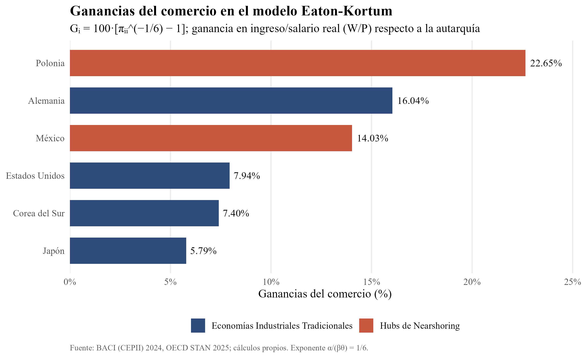
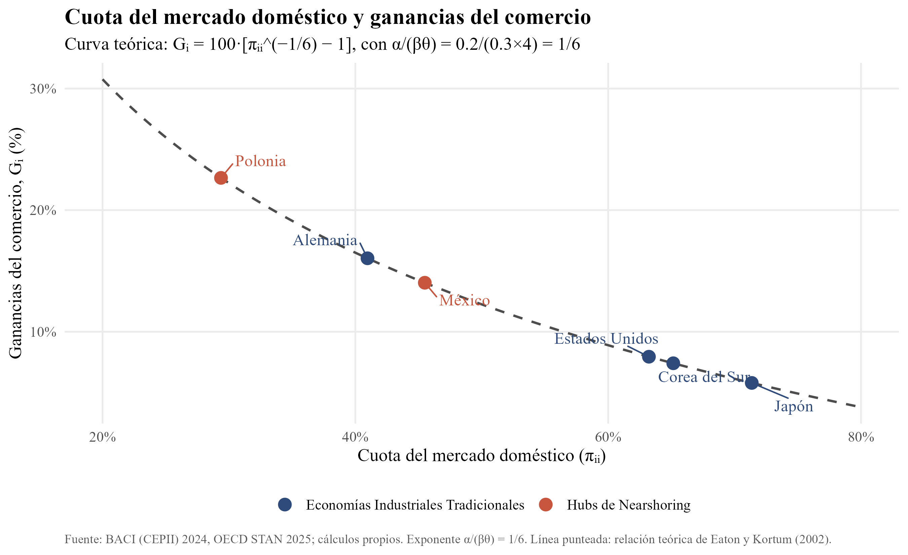

```{r setup, include=FALSE}
knitr::opts_chunk$set(echo = FALSE, message = FALSE, warning = FALSE)
library(tidyverse)
library(knitr)

theta <- 8.28
res <- read_csv("outputs/eaton_kortum_resultados.csv", show_col_types = FALSE) %>%
  mutate(
    pais = recode(iso3, MEX = "México", POL = "Polonia", USA = "Estados Unidos",
                  JPN = "Japón", KOR = "Corea del Sur", DEU = "Alemania"),
    grupo = if_else(iso3 %in% c("MEX", "POL"), "Hub de nearshoring", "Economía industrial tradicional")
  ) %>%
  arrange(desc(Gains_pct))

g <- function(code, col) res[[col]][res$iso3 == code]
pct <- function(x) sprintf("%.2f%%", x)

hubs  <- res %>% filter(grupo == "Hub de nearshoring")
trad  <- res %>% filter(grupo != "Hub de nearshoring")
```

# Resumen

Este informe estima las **ganancias del comercio** de seis economías manufactureras
(México, Polonia, Estados Unidos, Alemania, Japón y Corea del Sur) con la fórmula de
estadísticos suficientes de Arkolakis, Costinot y Rodríguez-Clare (2012), derivada del modelo
de Eaton y Kortum (2002). Combinamos flujos bilaterales de BACI (CEPII, 2024) con producción
manufacturera de OECD STAN. Las ganancias estimadas van de `r pct(min(res$Gains_pct))`
(`r res$pais[which.min(res$Gains_pct)]`) a `r pct(max(res$Gains_pct))` (`r res$pais[which.max(res$Gains_pct)]`).
Los dos hubs de nearshoring tienen una cuota doméstica menor y, por tanto, mayores
ganancias medidas que Estados Unidos, Japón y Corea del Sur.

# Marco teórico

## El modelo Eaton-Kortum (2002)

Hay $N$ países y un continuo de bienes $j \in [0,1]$. El costo de producir el bien $j$ en el país $i$ es
$c_i/z_i(j)$, donde $c_i$ es el costo del bloque de insumos y la productividad $z_i(j)$ se distribuye
Fréchet con $\Pr[z_i(j) \le z] = \exp(-T_i z^{-\theta})$. El parámetro $T_i$ mide la ventaja
absoluta del país y $\theta$ gobierna la dispersión de productividades (mayor $\theta$ implica menos
heterogeneidad y menor ganancia del comercio).

Con costos de comercio tipo iceberg $d_{ni} \ge 1$, el precio del bien $j$ en $n$ es
$p_n(j) = \min_i \{ c_i d_{ni}/z_i(j) \}$. Por las propiedades de la distribución Fréchet, la
probabilidad de que $i$ sea el proveedor más barato para $n$, que coincide con la participación
de $i$ en el gasto de $n$, es

$$
\pi_{ni} = \frac{T_i (c_i d_{ni})^{-\theta}}{\Phi_n}, \qquad
\Phi_n = \sum_{k=1}^{N} T_k (c_k d_{nk})^{-\theta}.
$$

El índice de precios exacto del país $n$ es proporcional a
$p_n = \gamma\, \Phi_n^{-1/\theta}$, con $\gamma$ una constante.

## Ganancias del comercio y la fórmula ACR (2012)

Tomando el caso doméstico, $\pi_{nn} = T_n c_n^{-\theta}/\Phi_n$, de modo que
$\Phi_n = T_n c_n^{-\theta}/\pi_{nn}$ y, por lo tanto,

$$
p_n = \gamma \left( \frac{T_n c_n^{-\theta}}{\pi_{nn}} \right)^{-1/\theta}
    = \gamma\, T_n^{-1/\theta}\, c_n\, \pi_{nn}^{1/\theta}.
$$

En autarquía ($\pi_{nn}=1$) el precio es $\gamma T_n^{-1/\theta} c_n$. Si se mantienen fijos
$T_n$ y el salario $c_n$, las ganancias, medidas como la variación equivalente del bienestar
respecto a la autarquía, son

$$
G_i = \frac{p_i^{\text{aut}}}{p_i} = \pi_{ii}^{-1/\theta}.
$$

Arkolakis, Costinot y Rodríguez-Clare (2012) muestran que esta expresión es robusta a una
amplia clase de modelos (Armington, Krugman, Melitz con Pareto, Eaton-Kortum). Lo único que
importa son dos estadísticos: la **cuota de gasto doméstico** $\pi_{ii}$ y la **elasticidad
del comercio** $\theta$. Aquí se usa $\theta = `r theta`$ (Simonovska y Waugh, 2014, entre otros).

## Construcción empírica

Para cada país $i$ en 2024:

- $X_i$ y $M_i$: exportaciones e importaciones totales de BACI, convertidas de miles de USD a USD.
- $Y_i$: producción manufacturera (OECD STAN, actividad C, medida P1, precios corrientes), convertida a USD con el tipo de cambio anual promedio del Banco Mundial.
- Absorción doméstica $D_i = Y_i + M_i - X_i$.
- Consumo interno de producción nacional $X_{ii} = Y_i - X_i$.
- Cuota doméstica $\pi_{ii} = X_{ii}/D_i$.
- Ganancias: $G_i = \pi_{ii}^{-1/\theta}$ y $\text{Gains\_pct} = (G_i - 1) \times 100$.

# Resultados

```{r tabla}
res %>%
  transmute(
    País = pais,
    Grupo = grupo,
    `Año OECD` = OECD_year,
    `Exportaciones (miles de mill. USD)` = X_i / 1e9,
    `Importaciones (miles de mill. USD)` = M_i / 1e9,
    `Producción manuf. (miles de mill. USD)` = Y_i / 1e9,
    `$\\pi_{ii}$` = pi_ii,
    `$G_i$` = Gains_from_Trade,
    `Ganancia (%)` = Gains_pct
  ) %>%
  kable(digits = c(0, 0, 0, 1, 1, 1, 3, 3, 2), format = "html",
        format.args = list(big.mark = ","), escape = FALSE,
        caption = "Cuota doméstica y ganancias del comercio, modelo Eaton-Kortum (θ = 8.28)")
```

*Fuentes: BACI (CEPII) 2024, OECD STAN (edición 2025) y Banco Mundial (tipos de cambio); cálculos propios.
Para Corea del Sur la última observación de OECD STAN es 2023.*

## Visualizaciones

```{r fig1, out.width="100%", fig.cap="Figura 1. Ganancias del comercio por país."}

```

**Figura 1.** Muestra las ganancias porcentuales respecto a la autarquía, ordenadas de mayor a menor.
Polonia (`r pct(g("POL","Gains_pct"))`) y México (`r pct(g("MEX","Gains_pct"))`) son los hubs de nearshoring.
Alemania (`r pct(g("DEU","Gains_pct"))`) es la economía tradicional con mayor ganancia, mientras que
Estados Unidos, Corea del Sur y Japón se ubican entre `r pct(min(trad$Gains_pct))` y `r pct(max(trad$Gains_pct[trad$iso3 != "DEU"]))`.

```{r fig2, out.width="100%", fig.cap="Figura 2. Cuota doméstica y ganancias del comercio."}

```

**Figura 2.** Ilustra la relación inversa y convexa entre la cuota doméstica $\pi_{ii}$ y las ganancias, según
$G_i = \pi_{ii}^{-1/\theta}$. Los puntos caen sobre la curva por construcción, ya que $G_i$ se calcula con esa
fórmula; la dispersión informa sobre **qué tan abierta** es cada economía, no sobre la validez del modelo.

# Análisis económico: nearshoring

## Hubs regionales frente a economías industriales tradicionales

Los dos hubs tienen una cuota doméstica más baja, es decir, una mayor integración con proveedores y
mercados externos:
`r paste0(hubs$pais, " (", sprintf("%.1f%%", 100 * hubs$pi_ii), ")", collapse = " y ")`,
frente a `r paste0(trad$pais, " (", sprintf("%.1f%%", 100 * trad$pi_ii), ")", collapse = ", ")`.

- **Polonia** presenta la mayor ganancia (`r pct(g("POL","Gains_pct"))`). Su inserción en las cadenas de valor de la Unión Europea, con Alemania como principal socio, genera un alto contenido de importaciones y reexportaciones.
- **México** (`r pct(g("MEX","Gains_pct"))`) se sitúa en un nivel similar al de Alemania (`r pct(g("DEU","Gains_pct"))`), con una integración comercial muy concentrada en Norteamérica bajo el T-MEC.
- **Estados Unidos, Japón y Corea del Sur** tienen mercados internos grandes o cadenas muy verticales dentro del país. Su cuota doméstica más alta se traduce en ganancias medidas más bajas.
- **Alemania** es un caso intermedio: es una economía industrial madura, pero muy abierta dentro del mercado único europeo.

## Interpretación y salvedades

1. **Tamaño y apertura.** Las economías pequeñas o más integradas regionalmente tienen un $\pi_{ii}$ más bajo y, mecánicamente, mayores ganancias. Esto no implica que sean más prósperas, sino que perderían más si regresaran a la autarquía.
2. **Comercio de valor agregado.** Las exportaciones brutas de BACI incluyen insumos importados. En economías con fuerte manufactura de ensamble, como México y Polonia, esto puede subestimar $\pi_{ii}$ y sobreestimar las ganancias frente a una medición en valor agregado.
3. **Alcance sectorial.** $Y_i$ es solo producción manufacturera, mientras que $X_i$ y $M_i$ son comercio total de mercancías. La razón $\pi_{ii}$ es, por tanto, una aproximación y no una cuota de gasto total.
4. **Parámetro $\theta$.** Se usa un valor único para todos los países. Los resultados se escalan con $1/\theta$: con un $\theta$ menor, las ganancias serían mayores.
5. **Datos y moneda.** La producción de OECD STAN está en moneda nacional y se convierte con tipos de cambio anuales promedio. Para Corea del Sur, la producción es de 2023 frente a flujos comerciales de 2024.
6. **Estática comparativa.** La fórmula ACR mide ganancias frente a la autarquía. No evalúa transiciones ni efectos distributivos, y tampoco mide directamente el efecto del nearshoring.

## Recomendaciones de política pública

Las siguientes recomendaciones se derivan de la lógica del modelo y deben validarse con análisis adicional.

1. **Preservar la apertura y reducir costos de comercio $d_{ni}$.** En el marco EK, bajar costos de transporte, aduanas y burocracia aumenta la participación de proveedores externos eficientes y eleva el bienestar. Conviene invertir en logística, cruces fronterizos, puertos y digitalización aduanera.
2. **Mantener la certidumbre del acuerdo comercial regional (México).** Dado que su ganancia depende de la integración con Norteamérica, es clave la estabilidad del T-MEC y de las reglas de origen.
3. **Elevar el contenido nacional de valor agregado de forma gradual (México y Polonia).** Hay que vincular proveedores locales a las cadenas globales con capacitación, financiamiento a pymes y encadenamientos productivos. El objetivo es capturar más valor, no reducir la apertura.
4. **Infraestructura y capital humano para el nearshoring.** Energía, agua, parques industriales y formación técnica son los cuellos de botella que limitan la capacidad de absorber relocalización de inversión.
5. **Diversificación de socios.** Si el aumento de $\pi_{ni}$ se concentra en pocos proveedores o mercados, la economía queda expuesta a choques. Los acuerdos con múltiples regiones reducen ese riesgo.
6. **Economías tradicionales (EE. UU., Japón, Corea del Sur).** Sus ganancias medidas son menores, pero su prioridad es la resiliencia de cadenas críticas. Conviene el *friend-shoring* con socios confiables, evitando barreras generales que reduzcan las ganancias del comercio.
7. **Compensación a los perdedores.** Las ganancias agregadas coexisten con costos de ajuste locales. Deben acompañarse de políticas activas de empleo y reconversión.

# Referencias

- Arkolakis, C., Costinot, A., y Rodríguez-Clare, A. (2012). New Trade Models, Same Old Gains? *American Economic Review*, 102(1), 94-130.
- Eaton, J., y Kortum, S. (2002). Technology, Geography, and Trade. *Econometrica*, 70(5), 1741-1779.
- Gaulier, G., y Zignago, S. (2010). BACI: International Trade Database at the Product-Level. *CEPII Working Paper* 2010-23.
- OECD (2025). *STAN Database for Structural Analysis*, edición 2025.
- Simonovska, I., y Waugh, M. (2014). The Elasticity of Trade: Estimates and Evidence. *Journal of International Economics*, 92(1), 34-50.
